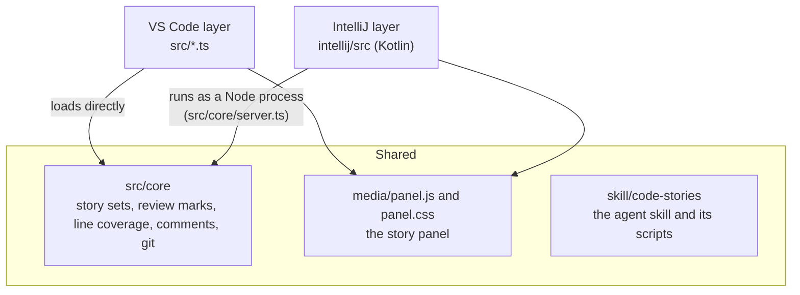

# Work on Code Story Walkthrough

## How the code is shared



The two editors use the same review logic and the same panel. Only the layer that talks to the
editor is different. The file formats are in `skill/code-stories/references/schema.md`.

## Build from source

You need Node.js. The IntelliJ plugin also needs Java 25.

```
npm install
npm run compile
```

- **VS Code extension:** `npm run package` makes the `.vsix` file. To try it on sample stories,
  press F5 in VS Code. It opens the `example/` folder.
- **IntelliJ plugin:** `cd intellij`, then `gradlew buildPlugin`. The zip file is in
  `intellij/build/distributions`. To build against an IDE that is on your computer, add
  `-PlocalIde="<path to the IDE>"`.
- **Agent skill:** it is the folder `skill/code-stories`. Copy it to a skills folder.

## Make a release

Set the same version in `package.json` and in `intellij/build.gradle.kts`. Then push a tag:

```
git tag v0.4.0
git push origin v0.4.0
```

The workflow in `.github/workflows/release.yml` builds the three downloads and publishes the
release.

## The website

The website is the `docs/` folder. GitHub Pages serves it from the `main` branch. The pages are
plain HTML files that share `docs/site.css` and `docs/site.js`.

To build the demo page again: `node docs/demo/build.mjs <project that has .stories>`.

## Make the pictures again

The pictures come from the IntelliJ plugin. A scripted run draws the IDE window into image files.
It does not read the screen.

```
cd intellij
gradlew runIde -PselfTest=<output folder> --args="<project that has .stories>"
```

Put a `script.txt` file in the output folder to control the run. The commands are at the top of
`intellij/src/main/kotlin/dev/codestories/SelfTest.kt`.

## Limits

- The line count includes added and changed lines. It does not include removed lines.
- The IntelliJ plugin is built and tested with version 2026.3 only.
- Pull request comments need the `gh` CLI. This path is not tested yet.
- The concerns in **Look closely** come from the agent that wrote the code. They can be
  incomplete.
