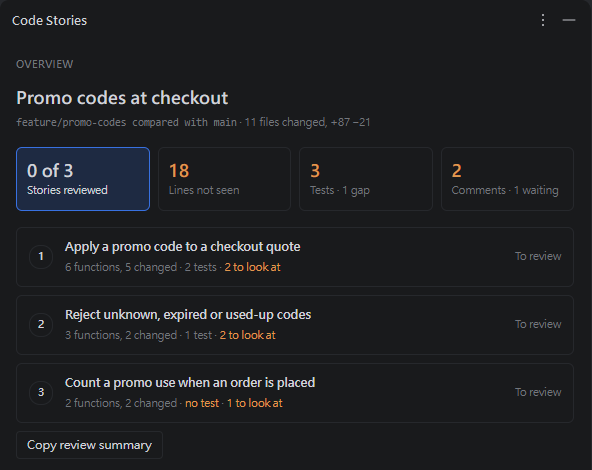
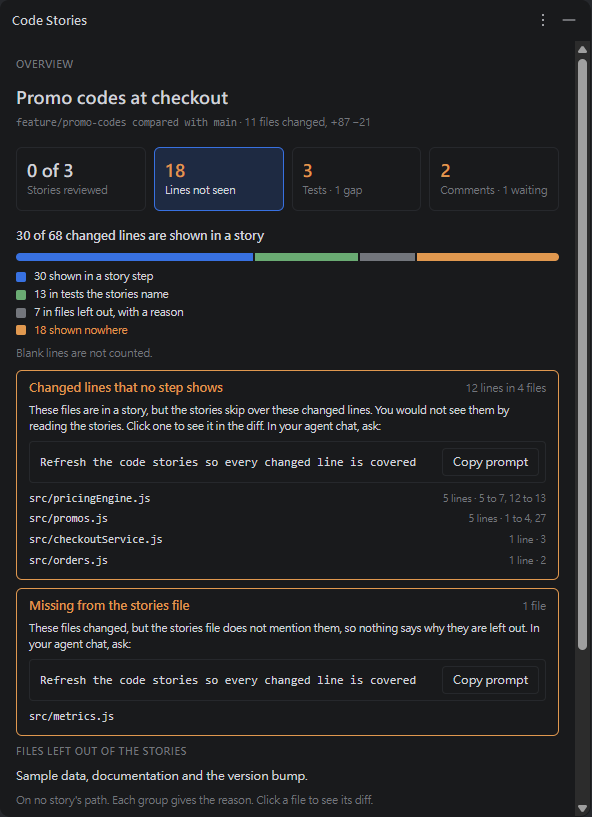
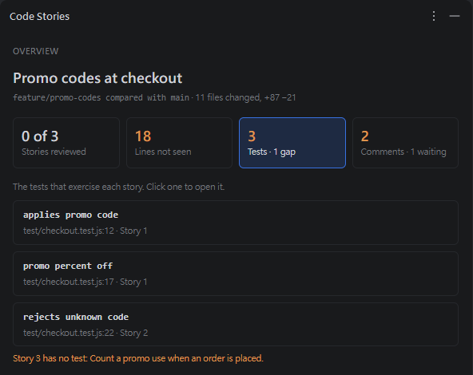

# Code Story Walkthrough

Review AI-written code in the order it runs.

Code Stories shows a change as a set of stories. Each story starts at an entry point and follows
the calls down to the code that changed. It works in VS Code and IntelliJ, with Claude Code and
other agents.


*One story, step by step. The editor on the left follows the story panel on the right.*

**Website:** [zachary-work.github.io/code-story-walkthrough](https://zachary-work.github.io/code-story-walkthrough/)
· [Tour](https://zachary-work.github.io/code-story-walkthrough/tour.html)
· [Agent skill](https://zachary-work.github.io/code-story-walkthrough/skill.html)
· [Get started](https://zachary-work.github.io/code-story-walkthrough/get-started.html)
· [Try the panel in your browser](https://zachary-work.github.io/code-story-walkthrough/demo/)

## Summary

### The agent is fast. The review is not.

AI agents write code fast. One request can change twenty files in a few minutes. A person must
still review that code.

A diff shows the files in alphabetical order. That order does not show how the code runs. You must
rebuild the call path in your head, for every change. This gives you two bad choices:

- **You read everything.** The review is complete, but you become the bottleneck.
- **You skim and approve.** The review is fast, but you miss a defect.

Code Stories removes this choice. It keeps the quality of a full review and makes the review
faster.

### The agent that wrote the change tells you how it runs.

The agent writes stories. You read the change in the order it runs, and the editor shows the real
code at each step.

1. **A story is one behaviour.** Something a user can see. Example: "A shopper can enter a promo
   code at checkout."
2. **It starts at an entry point.** A route, an event handler or a command.
3. **Each step is one function.** The steps follow the call path. The signature of the function is
   the first line.
4. **A step shows what changed there.** The changed lines of that function, and a sample input and
   output.

### You do not have to trust that the stories are complete.

The tool also checks the agent.

| Stories | Lines not seen | Tests |
| --- | --- | --- |
|  |  |  |
| The stories, and what each story needs from you. | Every changed line is counted. You see the lines that no step shows. | The tests that each story names. You see the stories that have no test. |

### A loop between you and the agent.

1. **The agent writes code.** You give the agent a task, as you do now.
2. **The agent writes stories.** The skill tells the agent how. A validator compares the stories
   with the diff.
3. **You read the stories.** In your editor, one step at a time. You write a comment where the
   code is not correct.
4. **The agent answers.** It changes the code, declines with a reason, or explains. Then you
   review only what is new.

The editor plugin and the agent exchange data through files in the `.stories/` folder of your
project. There is no account and no online service.

## Get started

You install two things: the agent skill, and the plugin for your editor. You do not have to clone
this repository. Each command downloads a file from the
[latest release](https://github.com/Zachary-work/code-story-walkthrough/releases/latest).

You need [Node.js](https://nodejs.org) on your PATH.

### 1. Install the agent skill

The skill is a folder of text files and scripts. The commands below put it in
`~/.claude/skills`, where Claude Code finds it for all your projects.

macOS and Linux:

```sh
mkdir -p ~/.claude/skills
curl -fsSL https://github.com/Zachary-work/code-story-walkthrough/releases/latest/download/code-stories-skill.tar.gz | tar -xz -C ~/.claude/skills
```

Windows (PowerShell):

```powershell
New-Item -ItemType Directory -Force "$HOME\.claude\skills" | Out-Null
curl.exe -fsSL -o "$env:TEMP\code-stories-skill.tar.gz" https://github.com/Zachary-work/code-story-walkthrough/releases/latest/download/code-stories-skill.tar.gz
tar -xzf "$env:TEMP\code-stories-skill.tar.gz" -C "$HOME\.claude\skills"
```

- For one project only, use `.claude/skills` in that project as the target folder.
- For agents other than Claude Code, use `.agents/skills`.
- To update the skill, run the same commands again.

### 2. Install the plugin for your editor

**VS Code**

```sh
curl -fsSL -o code-story-walkthrough.vsix https://github.com/Zachary-work/code-story-walkthrough/releases/latest/download/code-story-walkthrough.vsix
code --install-extension code-story-walkthrough.vsix
```

On Windows PowerShell, write `curl.exe` instead of `curl`. Then run **Code Stories: Open Story
Panel** from the command palette.

**IntelliJ** (IntelliJ-based IDEs, version 2026.3 or later)

1. Download [`code-story-walkthrough-intellij.zip`](https://github.com/Zachary-work/code-story-walkthrough/releases/latest/download/code-story-walkthrough-intellij.zip). Do not unzip it.
2. In the IDE, open **Settings > Plugins**, select the gear icon, then **Install Plugin from Disk**.
3. Select the zip file, then restart the IDE.

The **Code Stories** tool window is on the right. **Tools > Code Stories** contains the commands.

### 3. Create your first stories

Open a project that has a change on a branch. Tell your agent:

```
/code-stories create stories for this branch
```

`/code-stories` at the start makes sure that the agent uses the skill. Then open the story panel in
your editor. The panel shows the stories of the branch that is checked out.

## Learn more

The website has the rest:

- [Tour](https://zachary-work.github.io/code-story-walkthrough/tour.html): the review, screen by
  screen.
- [Agent skill](https://zachary-work.github.io/code-story-walkthrough/skill.html): the three
  prompts, the validator, the answers to your comments, and story sets.
- [Try the panel](https://zachary-work.github.io/code-story-walkthrough/demo/): the real panel in
  your browser, with sample stories.

To build the plugins from source or to make a release, see [CONTRIBUTING.md](CONTRIBUTING.md).
