# Code Story Walkthrough

Review a code change as a set of stories. Each story starts at an entry point and follows the
calls down to the code that changed.

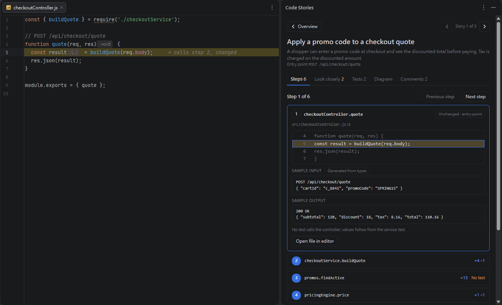

*One story, step by step. The editor on the left follows the story panel on the right.*

## Install

You install two things: the agent skill, and the plugin for your editor. You do not have to clone
this repository. Each command downloads a file from the
[latest release](https://github.com/Zachary-work/code-story-walkthrough/releases/latest).

### 1. The agent skill

The skill is a folder of text files and scripts. The commands below put it in
`~/.claude/skills`, where Claude Code finds it for all your projects. The scripts need
[Node.js](https://nodejs.org).

macOS and Linux:

```sh
mkdir -p ~/.claude/skills
curl -fsSL https://github.com/Zachary-work/code-story-walkthrough/releases/latest/download/code-stories-skill.tar.gz | tar -xz -C ~/.claude/skills
```

Windows (PowerShell):

```powershell
New-Item -ItemType Directory -Force "$HOME\.claude\skills" | Out-Null
curl.exe -fsSL -o "$env:TEMP\code-stories-skill.tar.gz" https://github.com/Zachary-work/code-story-walkthrough/releases/latest/download/code-stories-skill.tar.gz
tar -xzf "$env:TEMP\code-stories-skill.tar.gz" -C "$HOME\.claude\skills"
```

To install the skill for one project only, use `.claude/skills` in that project as the target
folder. For agents other than Claude Code, use `.agents/skills`.

To update the skill, run the same commands again.

### 2. The editor plugin

**VS Code**

```sh
curl -fsSL -o code-story-walkthrough.vsix https://github.com/Zachary-work/code-story-walkthrough/releases/latest/download/code-story-walkthrough.vsix
code --install-extension code-story-walkthrough.vsix
```

On Windows PowerShell, write `curl.exe` instead of `curl`. Then run **Code Stories: Open Story
Panel** from the command palette.

**IntelliJ** (IntelliJ-based IDEs, version 2026.3 or later; needs Node.js on your PATH)

1. Download [`code-story-walkthrough-intellij.zip`](https://github.com/Zachary-work/code-story-walkthrough/releases/latest/download/code-story-walkthrough-intellij.zip). Do not unzip it.
2. In the IDE, open **Settings > Plugins**, select the gear icon, then **Install Plugin from Disk**.
3. Select the zip file, then restart the IDE.

The **Code Stories** tool window is on the right. **Tools > Code Stories** contains the commands.

### 3. Create your first stories

Open a project that has a change on a branch. Tell your agent:

```
Create code stories for this branch
```

Then open the story panel in your editor.

## The problem

AI agents write code fast. One request can change twenty files in a few minutes.

A person must still review that code. The usual review reads a diff file by file, in alphabetical
order. That order does not show how the code runs. The reviewer must rebuild the call path in
their head, for every change.

This is slow. When the reviewer is slow and the agent is fast, there are two bad results:

- The reviewer reads everything and becomes the bottleneck.
- The reviewer skims, approves, and misses a defect.

Code Story Walkthrough removes this choice. It keeps the quality of a full review and makes the
review faster.

## The idea

The agent that wrote the change also knows how the change runs. So the agent writes **stories**:

- A story is one behaviour that a user can see. Example: "A shopper can enter a promo code at
  checkout."
- A story starts at an entry point: a route, an event handler or a command.
- A story has steps. Each step is one function on the call path.
- A step shows the lines that changed in that function, and a sample input and output.

You read the change in the order it runs. The editor shows the real code at each step.

The tool also checks the agent. It counts every changed line, and it tells you which lines no
story shows. You do not have to trust that the stories are complete.

## Try the panel

The story panel is a web page. You can try it without an install.

1. Clone this repository.
2. Open `docs/demo/index.html` in a browser.

The page contains the real panel and sample stories. A line at the top tells you what the editor
would do.

## How it works

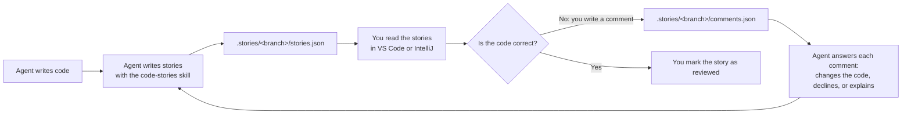

There are two parts. They exchange data through files in the `.stories/` folder of your project.

| Part | What it does |
| --- | --- |
| **Editor plugin** (VS Code and IntelliJ) | Shows the stories. Moves the editor to each step. Lets you write review comments. |
| **Agent skill** (`code-stories`) | Teaches the agent to write the stories and to answer your comments. |

## The review, screen by screen

The screens below show the IntelliJ plugin. The VS Code extension shows the same panel.

### 1. Start at the overview

The overview has four counters. Each counter is also a tab.

| Stories | Lines not seen | Tests |
| --- | --- | --- |
|  |  |  |
| The stories, and what each story needs from you. | Every changed line is counted. You see the lines that no step shows. | The tests that each story names. You see the stories that have no test. |

The fourth tab, **Comments**, contains your review threads.

### 2. Read a story, one step at a time

Open a story. Only the current step is open. The other steps are one line each.

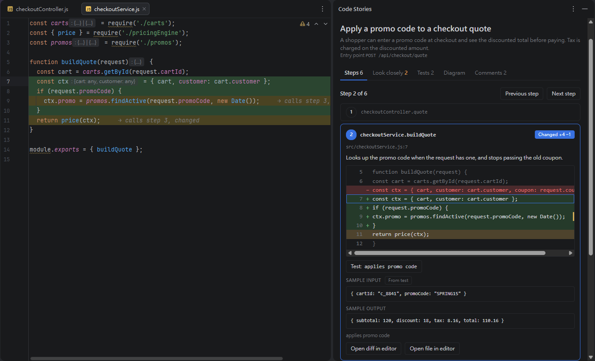

- Green lines are new or changed. Red lines are removed.
- The editor opens the same file at the same line, and marks the changed lines.
- Each step shows a sample input and output. If a test exists, the values come from the test.
- Select **Next step** to follow the call.

### 3. See what an excerpt leaves out

A step shows an excerpt, not the full function. The panel marks each gap.

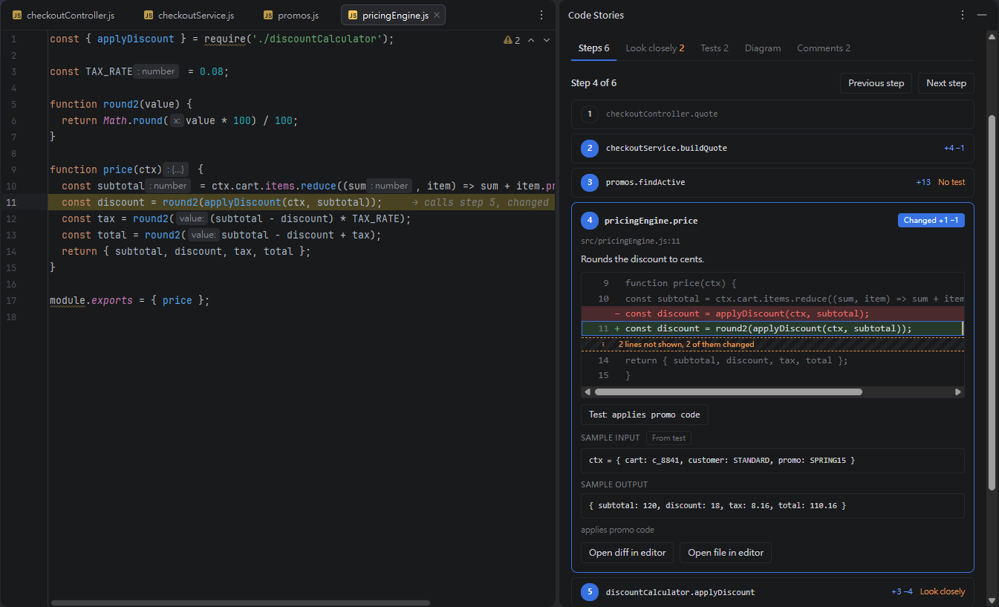

A grey gap hides unchanged lines. An orange gap hides **changed** lines. The panel also warns you
before you mark the story as reviewed.

### 4. See the code that the change removed

Removed code has no line in the current file. A story can still show it as a step.

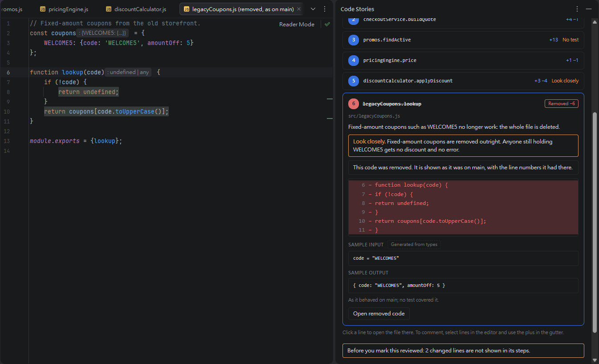

The editor opens the file as it was on the base branch.

### 5. Look where the agent was not sure

The agent lists the places that need a careful look. Each item opens its step.

| Look closely | Diagram |
| --- | --- |
| 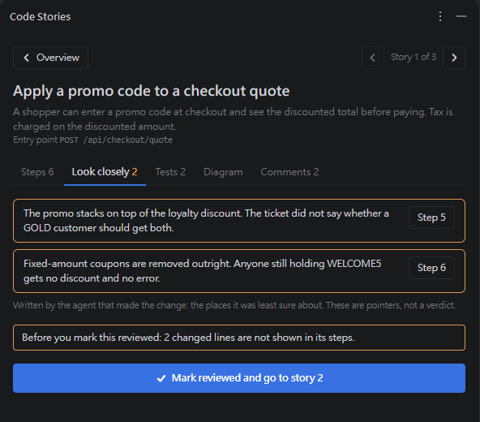 | 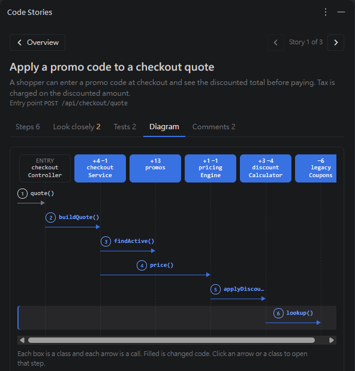 |
| The agent wrote these concerns. They are pointers, not a verdict. | The call path of the story. Filled boxes contain changed code. |

### 6. Compare with the base

Select **Open diff in editor** to see the full diff of a file against the base branch.

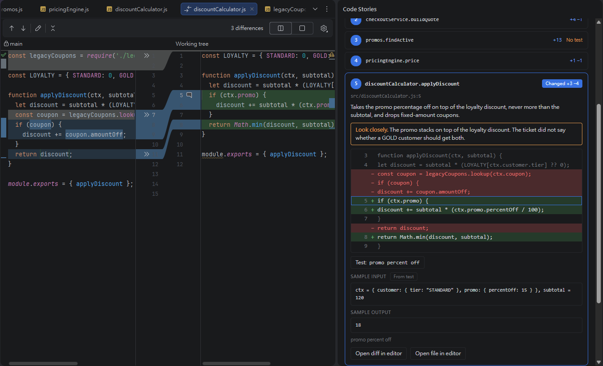

### 7. Write a comment

Select lines in the editor and add a review comment. A comment has two possible destinations:

- **Local.** The plugin saves it for your agent.
- **Pull request.** The plugin posts it to GitHub. This needs the [`gh` CLI](https://cli.github.com).

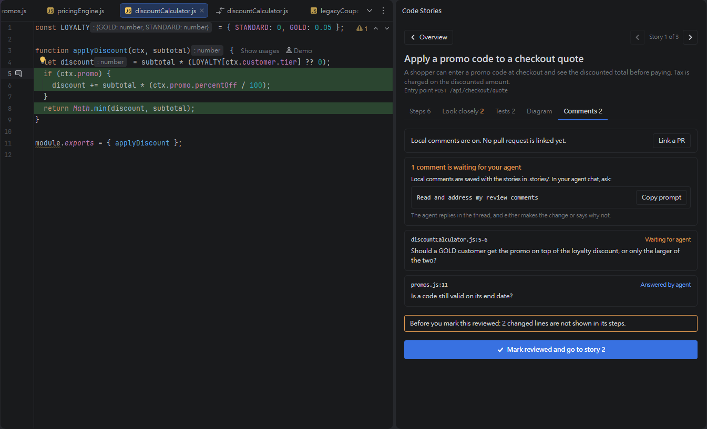

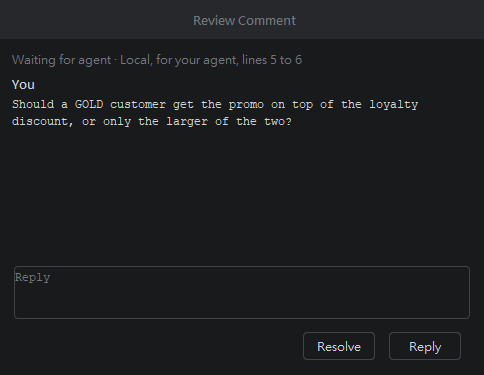

Then tell the agent: **"Read and address my review comments"**. The agent answers in the same
thread. It changes the code, declines with a reason, or answers the question.

### 8. Review only what changed

Mark each story as reviewed. If the agent changes a reviewed story, the panel shows **Changed
since review**. It marks the steps that changed and the lines that you did not read. Code that
only moved does not count as a change.

## The agent skill

The skill is in `skill/code-stories/`. It works with Claude Code and with other agents that read
skill folders.

### Create the stories

Tell the agent:

```
Create code stories for this branch
```

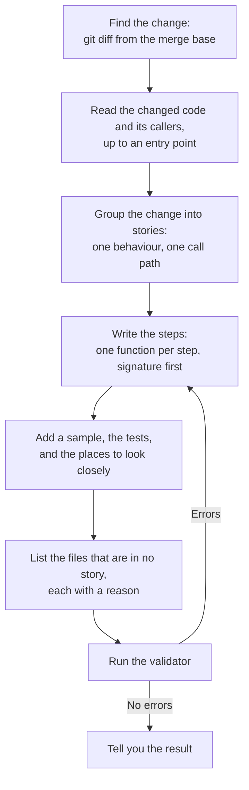

### The validator keeps the agent honest

The skill includes a script that compares the stories with `git diff`. The agent must run it and
correct every error.

```
$ node skill/code-stories/scripts/validate.mjs
Story set: feature-promo-codes (.stories/feature-promo-codes/stories.json)
Changed lines in storied files: 30 of 42 are shown in a step
warning: stories[2] (record-use): no tests listed. Name the tests that cover this story, ...
warning: src/pricingEngine.js: 5 changed line(s) are in no step (5-7, 12-13). Show them in a step, ...
... (4 more warnings)
error: src/metrics.js changed since main but is in no story and not in unstoried.files
3 stories, 1 error(s), 6 warning(s)
```

The validator makes sure that:

- Each quoted line is in the file, at that line number.
- A changed line is not labelled as unchanged.
- Each named test exists.
- Each changed file is in a story, or is left out with a reason.

### Answer your comments

Tell the agent:

```
Read and address my review comments
```

The agent reads each waiting comment and gives one of three answers:

| Answer | Meaning |
| --- | --- |
| **Changed** | The comment is correct. The agent changed the code and says where. |
| **Declined** | The agent did not change the code. It gives the reason. |
| **Answered** | The comment was a question. The agent answers it. |

### Refresh the stories

When the code changes after the stories were written, the panel tells you. Tell the agent:

```
Refresh the code stories so every changed line is covered
```

## Features

| Feature | What you get |
| --- | --- |
| Stories | The change, in the order it runs. |
| One function per step | Each step is one function. The signature is the first line. |
| Editor follows | The editor opens the file and line of each step. |
| Line coverage | A count of every changed line, and a list of the lines that no story shows. |
| Hidden-change warning | A gap that hides changed lines is orange. |
| Out-of-date warning | A step is marked when its code no longer matches the file. |
| Removed code | A deleted function can be a step. |
| Tests | Each story names its tests. Stories and steps without a test are marked. |
| Look closely | The agent lists its own doubts. |
| Sequence diagram | The call path of each story. |
| Samples | A real input and output for each step. |
| Review comments | Local comments for the agent, or comments on the pull request. |
| Re-review | After a change, you see only what is new. |
| Story sets | Each branch has its own stories and comments. |
| Review summary | The state of the review as text. |

## Story sets

Each change has its own folder. Two changes that you work on at the same time do not overwrite
each other.

```
.stories/
  feature-promo-codes/     stories.json, comments.json
  fix-tax-rounding/        stories.json, comments.json
```

- The folder has the name of the branch.
- On the default branch, the agent gives the folder the name of the change. If the agent cannot
  tell whether the work is a follow-up, it asks you.
- The panel shows the stories of the branch that is checked out.
- When there are two or more sets, the overview has a **Story set** list and a **Delete set**
  button.
- A `.stories/stories.json` file from an earlier version still works.

`.stories/` is review data for your working copy. Add it to `.gitignore`, unless you want to share
the stories with the pull request.

## How the code is shared

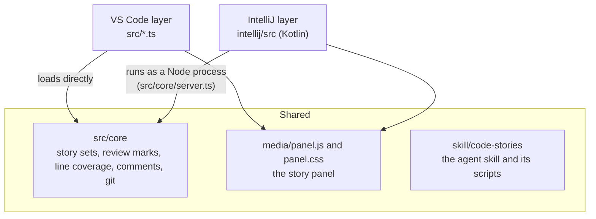

The two editors use the same review logic and the same panel. Only the layer that talks to the
editor is different. The file formats are in `skill/code-stories/references/schema.md`.

## Limits

- The line count includes added and changed lines. It does not include removed lines.
- The IntelliJ plugin is built and tested with version 2026.3 only.
- Pull request comments need the `gh` CLI. This path is not tested yet.
- The concerns in **Look closely** come from the agent that wrote the code. They can be
  incomplete.

## Build from source

You need Node.js. The IntelliJ plugin also needs Java 25.

```
npm install
npm run compile
```

- **VS Code extension:** `npm run package` makes the `.vsix` file. To try it on sample stories,
  press F5 in VS Code. It opens the `example/` folder.
- **IntelliJ plugin:** `cd intellij`, then `gradlew buildPlugin`. The zip file is in
  `intellij/build/distributions`. To build against an IDE that is on your computer, add
  `-PlocalIde="<path to the IDE>"`.
- **Agent skill:** it is the folder `skill/code-stories`. Copy it to a skills folder.

### Make a release

Set the same version in `package.json` and in `intellij/build.gradle.kts`. Then push a tag:

```
git tag v0.4.0
git push origin v0.4.0
```

The workflow in `.github/workflows/release.yml` builds the three downloads and publishes the
release.

## Make the pictures again

The pictures in this file come from the plugin. A scripted run draws the IDE window into image
files. It does not read the screen.

```
cd intellij
gradlew runIde -PselfTest=<output folder> --args="<project that has .stories>"
```

Put a `script.txt` file in the output folder to control the run. The commands are at the top of
`intellij/src/main/kotlin/dev/codestories/SelfTest.kt`.

To build the demo page again: `node docs/demo/build.mjs <project that has .stories>`.
